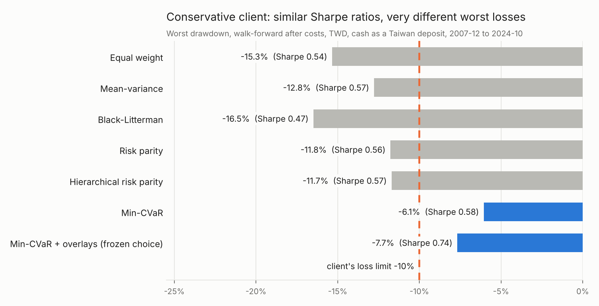

# Goal-Based Multi-Asset Portfolio Engine

[](https://github.com/klavarihards/Markets-Strategies/actions/workflows/portfolio-engine.yml)

## Key findings



- **No allocation method reliably beat equal weight on risk-adjusted return**
  (0 of 60 Sharpe comparisons significant in development, none in the
  hold-out). **They differed in how much a client can lose:** for a
  conservative client only the CVaR-minimising portfolio stayed inside the
  -10% loss limit (chart), which is what that client actually cares about.
- **What failed:** momentum tilts failed every test; regime and volatility
  overlays helped in 2008-09 and cost turnover otherwise; and my own
  pre-registered keep rule let an overlay package pass although it
  contained the failed tilt.
- **Out of sample** (the last two years, locked away and opened once) every
  client loss limit held, but the portfolios lagged a boom in which 100%
  Taiwan equity returned 42% a year.
- **With the real Taiwan-listed funds** (0050, 00646, 00645, 00679B,
  00697B, 00635U, mostly Yuanta) from July 2017 and cash at Taiwan deposit
  rates, the frozen portfolios returned 1.0-1.4% a year *more* than with
  the US-listed proxies; the gold fund lagged spot gold by 5.3% a year, and
  Taiwan cash cut the short-horizon clients' goal chances (78% to 73%,
  76% to 70%).

Educational research project, not investment advice. Clients are
hypothetical; fund names are used only as liquid, representative
Taiwan-listed instruments, not as recommendations.

The engine answers the question a wealth client asks: *what should I hold,
and how likely am I to reach my goal?* It builds portfolios for a
Taiwan-based investor from seven building blocks, compares six allocation
methods and three overlays walk-forward with costs and taxes, stress-tests
them, simulates goal probabilities, and turns the result into a one-page
client report behind an API and a dashboard.

| Read | For |
|---|---|
| [docs/project_brief.pdf](docs/project_brief.pdf) | two-page project brief |
| [REPORT.md](REPORT.md) | the research write-up: question, results, what failed |
| [RESEARCH_LOG.md](RESEARCH_LOG.md) | every iteration, bug and change of course, in order |
| [HOW_IT_WORKS.md](HOW_IT_WORKS.md) | each method explained, why it is there, what can go wrong |
| `notebooks/01`–`06` | the runs themselves (Colab-ready, outputs included); `06` = Taiwan funds and cash |
| `reports/` | sample one-page client reports (PDF) |

## Status

| Phase | Content | Status |
|---|---|---|
| 1 | Data snapshots, TWD returns, walk-forward backtest with costs, three benchmarks | Done; run on real data |
| 2 | Five allocation methods under three client risk profiles, cross-checked against PyPortfolioOpt / Riskfolio-Lib | Done; run on real data |
| 3 | Stress tests, risk decomposition, CVaR variant, Monte Carlo goal probabilities | Done; run on real data |
| 4 | GARCH volatility targeting, regime filters (rule and HMM), momentum tilts; pre-registered rules, robustness, deflated Sharpe | Done; run on real data |
| Hold-out | Last two years, opened once after everything was frozen | Done (`notebooks/04b`) |
| 5 | Questionnaire, advice engine, one-page PDF report, FastAPI, Streamlit, Docker, CI | Done; sample reports in `reports/` |
| Taiwan check | Frozen portfolios re-run with Taiwan deposit rates for cash and with the Taiwan-listed funds | Done (`notebooks/06`) |
| Views | Dated Black-Litterman views with stated confidence, scored afterwards | Mechanism built and tested; no views entered yet (`configs/views.yaml`) |

## Layout

```
configs/                 one YAML file per run; final_choice.yaml = the frozen portfolio per profile
data/snapshots/          frozen market data (hash-checked); data/macro/ = credit spreads;
                         data/taiwan/ = Taiwan-listed funds and CBC deposit rates
src/portfolio_engine/
  data/                  download, snapshots, synthetic test data, loader + hold-out lock, data-quality checks
  estimators/            Ledoit-Wolf covariance, historical means, Black-Litterman, dated views
  allocation/            benchmarks, risk profiles, six methods, overlays, shared cvxpy solver
  backtest/              costs, walk-forward engine, metrics, experiments, trial registry, Phase 4 studies
  risk/                  stress tests, risk decomposition, Monte Carlo goals
  product/               questionnaire, advisor, PDF report, FastAPI service, implementation check
app/streamlit_app.py     dashboard
experiments/             trial registry (every backtest) and the hold-out log
notebooks/               one Colab notebook per phase, plus 04b (hold-out) and 06 (Taiwan check)
scripts/                 key_findings_chart.py, project_brief.py: docs/ figures and the brief, from the results
tests/                   104 pytest tests, all on synthetic data (CI runs them on every push)
```

## Running it

**Colab:** open any notebook in `notebooks/` (the first cell clones the repo,
installs the package and, in Colab, keeps snapshots on Google Drive). The
committed snapshot is used automatically.

**Locally:**

```
pip install -e ".[dev,product]"
pytest                                            # 104 tests, synthetic data, no network
uvicorn portfolio_engine.product.api:app          # API: http://localhost:8000/docs
streamlit run app/streamlit_app.py                # dashboard
```

**Docker:** `docker compose up` (API on port 8000, dashboard on 8501). The image itself
was not built in the development sandbox (no Docker daemon); its recipe was verified with a
clean, non-editable install serving the API.

A public demo needs a host. The dashboard runs from any working directory and
is a candidate for Streamlit Community Cloud (`portfolio-engine/app/streamlit_app.py`);
that deployment has not been tested.

## Results

From the runs in `notebooks/01_data_and_baseline.ipynb` and
`notebooks/02_allocation_methods.ipynb`: snapshot `570bdef9e8ea` (downloaded
2026-10-23, committed in `data/snapshots/`), development data to 22 Oct 2024;
hold-out (23 Oct 2024 – 22 Oct 2026) not yet opened. Config hashes
`eb292432cba0` (Phase 1) and `03f45b1dbe9e` (Phase 2). All figures in TWD,
after costs. Cash is treated as a TWD deposit (see HOW_IT_WORKS section 2;
the first run converted it from USD and was redone before Phase 3).

**Baselines, 3-year window (31 Dec 2007 – 22 Oct 2024)**

| | Annual return | Volatility | Sharpe | Max drawdown | Cost drag / yr |
|---|---|---|---|---|---|
| Equal weight | 5.4% | 8.8% | 0.52 | -22.4% | 0.40% |
| 60/40 | 5.9% | 11.3% | 0.47 | -28.9% | 0.41% |
| 100% Taiwan equity | 8.2% | 23.6% | 0.41 | -58.1% | -0.16% |

(The Taiwan cost drag is negative because the assumed 0050 fee is below EWT's.)

**Five methods under three profiles, 3-year window: Sharpe (max drawdown)**

| Profile | Equal weight | Mean-variance | Black-Litterman | Risk parity | HRP |
|---|---|---|---|---|---|
| Conservative | 0.50 (-15.4%) | 0.50 (-14.8%) | 0.43 (-16.6%) | 0.52 (-11.8%) | 0.53 (-11.6%) |
| Balanced | 0.50 (-22.9%) | 0.45 (-27.0%) | 0.48 (-21.8%) | 0.54 (-18.3%) | 0.53 (-18.3%) |
| Growth | 0.44 (-35.1%) | 0.46 (-36.4%) | 0.50 (-30.8%) | 0.47 (-33.1%) | 0.46 (-33.4%) |

**5-year window (31 Dec 2009 – 22 Oct 2024)**

| Profile | Equal weight | Mean-variance | Black-Litterman | Risk parity | HRP |
|---|---|---|---|---|---|
| Conservative | 0.66 (-11.8%) | 0.70 (-12.3%) | 0.60 (-10.2%) | 0.62 (-12.9%) | 0.60 (-12.2%) |
| Balanced | 0.70 (-13.1%) | 0.79 (-17.3%) | 0.68 (-13.9%) | 0.68 (-13.2%) | 0.70 (-12.4%) |
| Growth | 0.64 (-18.4%) | 0.75 (-21.8%) | 0.72 (-19.3%) | 0.67 (-18.2%) | 0.65 (-18.2%) |

What the tables say:

- **No method is distinguishable from the benchmarks.** None of the 60 Sharpe
  differences against 1/N and 60/40 has a 90% bootstrap interval that excludes
  zero; all gaps lie between -0.08 and +0.14.
- **Mean-variance** has the highest Sharpe in every profile with the 5-year
  window, but trades 28-69% of the portfolio a year (others: 9-15%).
  With the 3-year window it is never the best.
- **Risk parity and HRP** gave the smallest drawdowns for conservative and
  balanced clients with the 3-year window, which includes 2008; with the
  5-year window that advantage is gone.
- **Black-Litterman without views** was the weakest for conservative clients.
- **Client limits:** the conservative -10% loss limit was breached by every
  method in both windows; the growth -30% limit by every method in the 3-year
  window; the balanced -20% limit by equal weight, mean-variance and
  Black-Litterman in the 3-year window. The volatility cap could not be met in
  16-18% of quarters for balanced and growth with the 3-year window, and
  20-25% for growth with the 5-year window.
- **The profile does much of the work:** risk parity and HRP were moved
  7-44% of the portfolio, on average, to fit the profile limits.

### Phase 3: risk and goals

From `notebooks/03_risk_and_goals.ipynb` (config `847159c84c0e`). Today's
portfolios are those chosen at the last quarter-end before the hold-out
(30 Sep 2024), with the 3-year window.

**Worst fall when today's weights are replayed through past crises (TWD)**

| Portfolio (today's weights) | 2008 GFC | 2011 euro | 2013 taper | 2020 COVID | 2022 inflation |
|---|---|---|---|---|---|
| Conservative: min-CVaR | -5.3% | -1.8% | -4.0% | -4.7% | -4.6% |
| Conservative: risk parity | -10.7% | -2.1% | -5.0% | -8.5% | -8.0% |
| Balanced: risk parity | -19.0% | -3.6% | -6.8% | -13.4% | -13.2% |
| Balanced: mean-variance | -31.8% | -9.3% | -4.6% | -18.6% | -10.5% |
| Growth: Black-Litterman | -29.0% | -7.8% | -7.3% | -19.6% | -14.3% |
| 60/40 | -26.5% | -6.7% | -7.6% | -16.7% | -16.8% |
| 100% Taiwan | -61.7% | -25.8% | -10.6% | -26.5% | -29.0% |

**Chance of reaching the goal (10,000 block-bootstrap paths of each portfolio's walk-forward returns after costs)**

| Client (goal) | Equal weight | Mean-variance | Black-Litterman | Risk parity | HRP | Min-CVaR | 60/40 |
|---|---|---|---|---|---|---|---|
| Conservative (NT$1.7M in 5 yrs) | 88% | 85% | 85% | 90% | 90% | 89% | 86% |
| Balanced (NT$3M in 10 yrs) | 78% | 74% | 79% | 83% | 81% | 79% | 80% |
| Growth (NT$12M in 30 yrs) | 51% | 63% | 60% | 56% | 53% | 68% | 46% |

What the analysis says:

- **The CVaR variant was the only method that kept a conservative client
  inside the -10% loss limit**: worst walk-forward drawdown -6.0% (3-year
  window) and -5.9% (5-year), and at most -5.3% in every replayed crisis.
  It gave up return for it (3.3% a year, Sharpe 0.54).
- **The conservative profile is internally inconsistent.** Its 7% volatility cap
  implies a 1-in-20 bad year of about 11.5% (1.645 x 7%), already beyond
  the client's own -10% limit. A calibration change is tested in Phase 4.
- **Money is not risk.** 60/40 has 60% of its money in equities and 75% of its
  volatility from them; balanced mean-variance 60% and 96%.
- **Shocks:** a 2-point rise in US rates costs up to -9.8% (60/40); if every risky
  sleeve moved together (correlation 0.8), a 1-in-20 bad year for the conservative
  portfolios would be -11.0% to -16.1%, all beyond their limit.
- **Goals:** conservative and balanced clients reach their goals in 74-90% of
  simulated futures whatever the method; the 30-year growth client is where the
  choice matters (46% with 60/40, 63% mean-variance, 68% min-CVaR). For the balanced
  client with risk parity, NT$2,000 more a month raises the odds from 83%
  to 94%, two more years to 98%.
- **Model choice matters in the tail.** For the growth client, the chance of a
  fall beyond -30% is 23%-56% with the bootstrap but 7%-24% with a fitted
  Student-t: resampling whole years keeps crashes clustered; a fitted distribution
  spreads them out. Both are reported.
- **Statistics:** 3 of the 72 Sharpe comparisons (now including min-CVaR) are
  "significant" at 90%, but about 7 would be by chance alone. Not evidence of an edge.

### Phase 4: overlays and robustness

From `notebooks/04_overlays_and_robustness.ipynb` (config `7a10877139aa`).
The decision rules were pre-registered in `RESEARCH_LOG.md` and committed
before the runs. 108 overlay backtests plus 11 robustness settings.

| Overlay (median method, change vs core) | Conservative | Balanced | Growth | Kept for |
|---|---|---|---|---|
| GARCH volatility target | +3% risk, -0.01 Sharpe | +21%, +0.04 | +36%, +0.08 | balanced, growth |
| Regime filter (rule) | +16%, +0.05 | +25%, +0.05 | +16%, +0.04 | all |
| Regime filter (HMM) | +14%, +0.02 | +25%, +0.04 | +16%, +0.03 | all |
| Momentum tilt (Black-Litterman views) | +2%, -0.01 | -2%, -0.02 | +1%, -0.01 | none |

("risk" = relative improvement in max drawdown or monthly CVaR.) The benefit
comes almost entirely from 2008-09. **Frozen choice:** conservative min-CVaR
+ all overlays (Sharpe 0.69, worst drawdown -7.4%); balanced min-CVaR + HMM
regime filter (0.60, -12.6%); growth Black-Litterman + all overlays (0.60,
-18.2%). Deflated Sharpe ratios after 223 distinct trials: 0.97 / 0.94 /
0.94 (equal weight 0.89, 60/40 0.84). Min-CVaR had the best Sharpe in 9 of 11
robustness settings; mean-variance was the most fragile.

### Hold-out (23 Oct 2024 – 22 Oct 2026), opened once

| | Annual return | Volatility | Sharpe | Worst drawdown | Client limit |
|---|---|---|---|---|---|
| Conservative choice | 9.5% | 6.3% | 0.85 | -5.2% | -10% (held) |
| Balanced choice | 11.8% | 7.4% | 1.01 | -6.0% | -20% (held) |
| Growth choice | 13.9% | 12.7% | 0.78 | -10.0% | -30% (held) |
| Equal weight | 15.2% | 10.9% | 0.99 | -7.1% | |
| 60/40 | 15.6% | 12.8% | 0.89 | -10.4% | |
| 100% Taiwan equity | 42.3% | 27.6% | 1.27 | -23.5% | |

Every loss limit held; no Sharpe difference is significant; no overlay
passed the keep rule out of sample (no stressed period to protect against).

### Phase 5: the product

From `notebooks/05_product_demo.ipynb`. Three hypothetical clients answer six
questions and get a one-page report (`reports/sample_report_*.pdf`); the same
engine serves `POST /advice` and `POST /report`. Implementation check: 0050
vs EWT in TWD, monthly 2009-2026, correlation 0.92 and tracking error 7.7% a
year, after repairing an unadjusted 4-for-1 split in Yahoo's 0050 history.

### Taiwan reality check: Taiwan cash and the real Taiwan-listed funds

From `notebooks/06_taiwan_reality_check.ipynb` (config `configs/taiwan.yaml`,
Taiwan snapshot `005d4d80deef`). The frozen portfolios are re-run, not
re-chosen.

**Cash as a TWD deposit at the CBC five major banks' 1-month rate** (also the
risk-free rate):

| | Development Sharpe (worst drawdown) | Hold-out return | Hold-out Sharpe (worst drawdown) |
|---|---|---|---|
| Conservative choice | 0.74 (-7.7%) | 8.5% | 1.13 (-5.8%) |
| Balanced choice | 0.63 (-12.5%) | 10.5% | 1.22 (-6.1%) |
| Growth choice | 0.63 (-18.2%) | 13.4% | 0.97 (-10.0%) |
| Equal weight | 0.55 (-22.3%) | 14.7% | 1.21 (-7.2%) |
| 100% Taiwan equity | 0.42 (-58.1%) | 42.3% | 1.37 (-23.5%) |

Sharpe ratios rise because the TWD rate (0.35-2.2% since 2004) is lower than
the T-bill; returns of cash-heavy portfolios fall. Min-CVaR is still the only
method within the conservative -10% limit (-6.1%). In the product, Taiwan
cash lowers the short-horizon clients' goal chances from 78% to 73% (Ms. Lin)
and 76% to 70% (Mr. Chen); the 30-year growth client is unchanged at 81%.

**Funds vs proxies, monthly in TWD, July 2017 – Oct 2026:**

| Sleeve | Fund | Correlation | Tracking error | Return gap (fund − proxy) |
|---|---|---|---|---|
| Taiwan equity | 0050 | 0.93 | 8.0% | +4.4% |
| US equity | 00646 | 0.94 | 5.1% | -0.9% |
| International equity | 00645 (Japan only) | 0.68 | 10.7% | +3.2% |
| Long Treasuries | 00679B | 0.94 | 4.3% | -0.3% |
| Intermediate Treasuries | 00697B | 0.96 | 2.0% | -0.4% |
| Gold | 00635U (futures) | 0.87 | 7.9% | -5.3% |

**Frozen portfolios' trades replayed with the funds** (next-Taipei-day
execution, spreads, commission, 0.1% sell tax): conservative +1.0% a year
against the proxies (tracking error 1.7%), balanced +1.2% (3.0%), growth
+1.4% (4.1%), with similar worst drawdowns. About 0.7% a year is the funds'
own returns (0050 and 00645 ahead of their proxies, 00635U behind); 0.2-0.6%
is holding costs the research charged that fund prices already contain.
Nine years is one sample with a long Taiwan boom.
